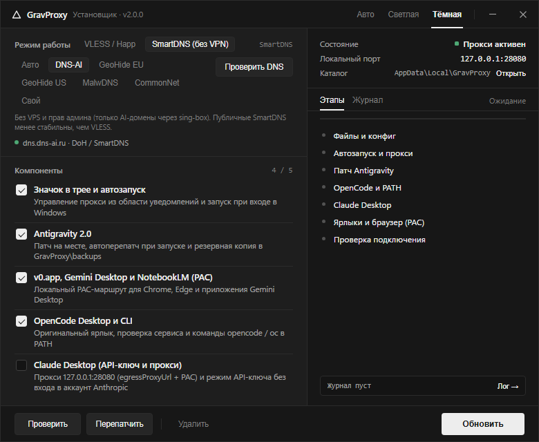

# GravProxy (`grav-proxy`)

[Русский](./README.md) · **English**

  

A portable, single-file local proxy (`127.0.0.1:28080`) and PAC router (`127.0.0.1:28081`) installer powered by `sing-box` (`1.14.4`, `windows/amd64`) for **Antigravity 2.0**, **v0.app**, **Gemini Desktop**, **NotebookLM**, **OpenCode Desktop / CLI**, and **Claude Desktop** on Windows 10/11 x64.

The standalone executable [`GravProxy.exe`](./GravProxy.exe) is available on the [Releases](https://github.com/qlfu/grav-proxy/releases/latest) page (`SHA-256` for `v1.6.0`: `C4DE07CA099C81E10AACED65AE135C8E8361C042ABA9C7668C8971BD2D5A949C`).

> Note: Installer and tray UI labels are currently in Russian; key menu items are noted below alongside their English meanings.

<p align="center">
  
</p>

---

## Problems Solved

- **Fixes `Antigravity 2.0` errors**:
  - `User location is not supported`
  - `Agent execution terminated due to error.`
  - `There was an unexpected issue setting up your account.` (`Your account is not eligible for Gemini Code Assist for individuals at this time`)
  Automatically picks a clean **VLESS** node (from **Happ** or your subscription URL) verified via **Google GeoIP** and patches `agy.exe` / `language_server*.exe` in-place with rollback backups in `backups\`.
- **Claude Desktop proxy & API-key mode (`3p`) on Windows**: writes `egressProxyUrl = http://127.0.0.1:28080` and optionally enables `deploymentMode: "3p"` (`sk-ant-...`, `sk-or-...`, or custom gateway) without administrator privileges.
- **Unblock Gemini Desktop, NotebookLM, v0.app, and OpenCode without slowing down your internet**: serves a local `sing-box` PAC router at `http://127.0.0.1:28081/proxy.pac` so **only AI domains** go through the proxy while all other traffic stays `DIRECT`.

---

## Features

- **Single `.exe` executable**: extracts components into a temporary directory (`%TEMP%\ag-proxy-sfx-*`), runs the WPF GUI in-process with a native taskbar icon (no separate PowerShell window), and cleans up temporary files on exit. Bundles `sing-box.exe` (with automatic download fallback from `SagerNet/sing-box` on GitHub if missing).
- **Auto-detection for VLESS / Happ & upstream proxy mode**:
  - Finds keys or subscriptions from the **Happ** client (`subscription_log.txt`, Happ configs/registry) or user environment variables `AG_PROXY_VLESS` / `AG_PROXY_SUB_URL`.
  - Supports direct upstream `socks5://...` / `http://...` URIs (e.g., `socks5://127.0.0.1:10808` while Happ is running) and automatically falls back to Happ's local proxy if the subscription URL is blocked by an ISP.
  - Tests nodes through real `sing-box` against **Google GeoIP** (filtering out FakeIP and unsupported locations) and picks the fastest working node.
- **In-place patching without duplicates**:
  - Patches `agy.exe` and `language_server*.exe` in-place while storing original backups and a SHA-256 manifest in `%LOCALAPPDATA%\ag-proxy\backups\`.
  - Updates existing Antigravity and OpenCode shortcuts (Desktop, Start Menu, Taskbar) via self-checking launchers (`ag_launch.exe` / `oc_launch.exe`) while preserving original icons.
  - Automatically verifies and restores patches on every app launch and periodically from the tray app.
- **v0.app, Gemini Desktop, and NotebookLM via local PAC**:
  - Runs a local PAC server at `http://127.0.0.1:28081/proxy.pac` for WinINet, Chrome/Edge, and **Gemini Desktop** (without modifying `Gemini.exe`, keeping `Alt+Space` and auto-updates intact).
  - Routes only targeted AI domains through the proxy (`v0.app`, `vercel.*`, `gemini.google.com`, `notebooklm.google.com`, `notebook.google.com`, `cloudcode-pa.googleapis.com`, `opencode.ai`, `openrouter.ai`, `api.openai.com`, `api.anthropic.com`, `anthropic.com`, `claude.ai`, `claude.com`, `claude.app`, `claudeusercontent.com`, `claudemcpcontent.com`, etc.); all other traffic stays `DIRECT`.
- **Claude Desktop (proxy + optional API key without Anthropic sign-in)**:
  - Stops running `Claude.exe` processes cleanly before updating config, removes conflicting `hybridPointer` entries, and writes `egressProxyUrl = http://127.0.0.1:28080` to `%LOCALAPPDATA%\Claude-3p\configLibrary\` (as well as MSIX VFS `Packages\Claude_*\LocalCache\Local\Claude-3p` and existing `%APPDATA%\Claude-3p`), requiring no admin privileges.
  - When an API key (`sk-ant-...` or `sk-or-...` / custom gateway with `Base URL` and `Bearer` / `x-api-key` auth scheme) is provided, sets `deploymentMode: "3p"` so Claude Desktop works without mandatory `claude.ai` sign-in.
  - Checks installed Claude Desktop versions (`>= 1.44121.1` for proxy, `>= 4.16336.0` for full `3p`) and warns if `HKLM` or `HKCU\Software\Policies\Claude` overrides local settings.
- **System tray controller (`proxy-tray.exe`)**:
  - Launches GravProxy settings directly via **«Открыть GravProxy»** (*Open GravProxy*, using `%LOCALAPPDATA%\ag-proxy\GravProxy.exe`).
  - Automatic GitHub update checking (tray balloon + **«Проверить обновления»** / *Check for updates* item, as well as prompt on installer launch) with `PE/EXE` and `SHA-256` verification before launching the downloaded build.
  - Color status icon, proxy toggle (PAC automatically returns `DIRECT` while paused), automatic clean-node failover, manual server picker, connectivity probe, **«Проверить и перепатчить всё»** (*Check and repatch all*, including Claude Desktop), quick app launchers (**Antigravity**, **v0.app**, **Gemini Desktop**, **NotebookLM**, **OpenCode**, **Claude**), `proxy.log` viewer, and install folder shortcut.
- **Cleanup of conflicting bypasses and stale autostart**:
  - Removes conflicting DNS/NRPT rules, `ag_dns.exe`, `AG Unlocker` scheduled tasks, legacy `v0-chrome` profile, and AI entries in `hosts` (leaving unrelated entries untouched; UAC is only requested if privileged conflicts exist).
  - Cleans broken/legacy Startup entries (`*.disabled`, `Run-Proxy.vbs`, `Update-Egress.vbs`, and stale `HKCU\...\Run` / scheduled task items).
- **No admin rights required & clean uninstall**: installs into `%LOCALAPPDATA%\ag-proxy` and fully reverts changes on uninstall.

---

## System Requirements

- **OS**: Windows 10 or Windows 11 (x64).
- **Built-in Windows components**: `.NET Framework 4.5+`, `PowerShell 5.1`, `curl.exe`.
- **Administrator rights**: not required.
- **Proxy / VPN**: **Happ** client with an active subscription/local proxy (`10808`/`10809`), or a `vless://...` / `https://...` / `socks5://...` URL.

---

## Quick Start (GUI)

1. Download [`GravProxy.exe`](./GravProxy.exe) from [Releases](https://github.com/qlfu/grav-proxy/releases/latest) and double-click to run.
2. **Proxy Server (VLESS / Happ)**:
   - Leave the input blank for automatic detection (`AG_PROXY_VLESS`, `AG_PROXY_SUB_URL`, or Happ), or click **«Найти в Happ»** (*Detect in Happ*).
   - If newer Happ versions encrypt `subs.db` or your ISP blocks the subscription URL, paste your `https://...` subscription URL, `vless://...` key, or local proxy address `socks5://127.0.0.1:10808` (with Happ connected to Netherlands/Poland).
3. **Components**: select what to configure (`Tray & Autostart`, `Antigravity 2.0` / `Antigravity IDE`, `v0.app / Gemini Desktop / NotebookLM`, `OpenCode Desktop & CLI`, `Claude Desktop`). For `Claude Desktop`, optionally enter an API key, `Base URL`, and toggle `Bearer` / `x-api-key`.
4. Click **«Установить»** (*Install*) — or **«Перепатчить»** (*Repatch*) to re-sync patches and Claude Desktop settings without rebuilding the proxy key.
5. Click **«Проверить»** (*Test*) to check external IP, Google GeoIP, Antigravity, v0.app, Gemini, NotebookLM, OpenCode, OpenRouter, and Claude / Anthropic API.

> Supports theme switching (`Auto` / `Light` / `Dark`) and closing the window with `Esc` when no task is running.

---

## Usage After Installation

- **GravProxy**: open anytime from the system tray icon → **«Открыть GravProxy»** (*Open GravProxy*).
- **Antigravity 2.0** & **OpenCode Desktop**: launch normally from your existing shortcuts.
- **OpenCode CLI**: run `opencode`, `oc`, or `opencode-proxy` in a new terminal window.
- **Claude Desktop**: launch normally or via **«Открыть Claude»** (*Open Claude*) in the tray menu.
- **Gemini Desktop**: launch normally or press `Alt+Space` (routes through PAC `:28081` while the proxy is active).
- **v0.app** & **NotebookLM**: open in Chrome or Edge while the proxy is running.
- **Custom PAC domains**: create `%LOCALAPPDATA%\ag-proxy\pac-domains.txt` (one domain per line; lines starting with `#` are ignored).

---

## Command-Line Mode (CLI)

Passing any arguments starts [`GravProxy.exe`](./GravProxy.exe) in console mode:

```powershell
# Full unattended install
.\GravProxy.exe -Cli

# Install with explicit VLESS, subscription, or local SOCKS5/HTTP proxy
.\GravProxy.exe -VlessUrl "vless://..."
.\GravProxy.exe -SubUrl "https://example.com/sub"
.\GravProxy.exe -VlessUrl "socks5://127.0.0.1:10808"

# Re-patch Antigravity, OpenCode, Claude Desktop, and shortcuts
.\GravProxy.exe -PatchOnly

# Configure Claude Desktop with an API key
.\GravProxy.exe -Cli -ClaudeApiKey "sk-ant-..."
.\GravProxy.exe -Cli -ClaudeApiKey "sk-or-v1-..." -ClaudeBaseUrl "https://openrouter.ai/api" -ClaudeAuthScheme x-api-key

# Full uninstall and rollback
.\GravProxy.exe -Uninstall
```

| Flag | Description |
| --- | --- |
| `-TargetRoot <path>` | Install directory (default: `%LOCALAPPDATA%\ag-proxy`) |
| `-VlessUrl <url>` | `vless://...`, `socks5://...`, `http://...`, or `https://...` subscription URL |
| `-SubUrl <url>` | Subscription URL with automatic Google GeoIP clean-node selection |
| `-ClaudeApiKey <key>` | Claude Desktop API key (`sk-ant-...`, `sk-or-...`, or gateway key) |
| `-ClaudeBaseUrl <url>` | Custom `inferenceGatewayBaseUrl` for Claude Desktop |
| `-ClaudeAuthScheme <scheme>` | Gateway auth scheme: `bearer` (default) or `x-api-key` |
| `-PatchOnly` | Only re-patch Antigravity / shortcuts / PAC / OpenCode / Claude Desktop and clean stale autostart |
| `-Uninstall` | Close blocking apps, restore originals, and delete installation |
| `-SkipTray` | Do not compile/run `proxy-tray.exe` (use headless `sing-box-bg.exe` instead) |
| `-SkipTask` | Do not register `HKCU\...\Run` autostart |
| `-SkipAntigravity` | Skip Antigravity IDE patching |
| `-SkipV0` | Disable local browser PAC setup |
| `-SkipOpenCode` | Skip OpenCode Desktop / CLI and `PATH` setup |
| `-SkipClaudeDesktop` | Skip Claude Desktop proxy and `3p` config setup |
| `-SkipShortcuts` | Do not modify app shortcuts |
| `-SkipPath` | Do not modify user `PATH` |

---

## File Locations

- `%LOCALAPPDATA%\ag-proxy\`:
  - `GravProxy.exe` — copy of the installer launched from the tray menu.
  - `sing-box.exe`, `sing-box.json`, `sing-box.template.json` — proxy core and config.
  - `proxy-tray.exe`, `sing-box-bg.exe` — system tray controller and local PAC server (`:28081`).
  - `ag_launch.exe`, `oc_launch.exe` — launchers with automatic patch and shortcut checks.
  - `backups\` — original Antigravity backups (`manifest.json` + `*.bak`) and moved legacy Startup items (`startup-disabled\`, `startup-legacy\`).
  - `shortcuts-backup.json`, `pac-backup.json`, `proxy.log`.
- `%LOCALAPPDATA%\Claude-3p\configLibrary\` — local `3p` configuration for Claude Desktop.

---

## Security, Privacy, SmartScreen, and Antivirus

- **No embedded keys or telemetry**: see [SECURITY.md](./SECURITY.en.md) for local credential storage details, `SHA-256` verification, and details on the encrypted runtime container inside `GravProxy.exe`.
- **Windows Defender SmartScreen**: `GravProxy.exe` is not signed with a commercial EV certificate, so Windows may show *"Windows protected your PC"* on first launch — click **More info → Run anyway** after verifying the `SHA-256` digest against the Releases page.
- **Antivirus false positives (`Trojan:Win32/Sabsik.FL.A!ml`, `Wacatac.B!ml`, etc.)**: machine-learning/heuristic scanners in Windows Defender and third-party AV tools frequently flag unsigned single-file executables that decrypt an embedded resource (`GravProxy.pkg`) into `%TEMP%\ag-proxy-sfx-*`, invoke `csc.exe`, and register a local PAC proxy / `HKCU\...\Run` entry. Verify the file `SHA-256` against the GitHub Release (`v1.6.0`: `C4DE07CA099C81E10AACED65AE135C8E8361C042ABA9C7668C8971BD2D5A949C`) and add `GravProxy.exe` or `%LOCALAPPDATA%\ag-proxy` to Windows Security exclusions if Defender blocks it.

---

## FAQ

**Antigravity 2.0 region / agent / account errors (`User location is not supported`, `Agent execution terminated due to error.`, `Your account is not eligible for Gemini Code Assist for individuals at this time` / `There was an unexpected issue setting up your account.`)**
Open the tray menu → **«Подобрать сервер (Google GeoIP)»** (*Select clean server*), or click **«Найти в Happ»** and reinstall the config using a clean node in a supported Google region (e.g., Netherlands, Germany, US, or Poland), then restart Antigravity 2.0.

**Happ is not detected (`subs.db` encrypted or subscription blocked by ISP)**
Paste the `https://...` subscription URL or `vless://...` key manually, or turn on Happ (e.g., Netherlands/Poland) and enter `socks5://127.0.0.1:10808` (or `http://127.0.0.1:10809`).

**Claude Desktop patch does not take effect**
Ensure Claude Desktop is up to date from `claude.ai/download` (`>= 1.44121.1` for `egressProxyUrl`, `>= 4.16336.0` for full `3p`), run `GravProxy.exe v1.4.0` (or **«Проверить и перепатчить всё»** in the tray), and check for `HKLM`/`HKCU\Software\Policies\Claude` registry policies:

```powershell
Get-AppxPackage *Claude* | Select Name,Version; foreach($k in 'HKLM:\SOFTWARE\Policies\Claude','HKCU:\Software\Policies\Claude'){if(Test-Path $k){$k; Get-ItemProperty $k}}; Get-Content "$env:LOCALAPPDATA\Claude-3p\configLibrary\_meta.json" -EA 0; Select-String -Path "$env:LOCALAPPDATA\Claude\logs\main.log","$env:LOCALAPPDATA\Claude-3p\logs\main.log" -Pattern 'managedConfig|egress-proxy|deploymentMode|Error|fail' -EA 0 | Select -Last 25
```

**"Select an app to open `.disabled` file" or missing `Run-Proxy.vbs` popup on Windows sign-in**
Run `GravProxy.exe v1.4.0` (*Install* or *Repatch*) — it automatically moves broken `.disabled` files and cleans stale `Run-Proxy.vbs` autostart items.

**Port `127.0.0.1:28080` already in use**
Exit any existing tray instance via **«Выход»** (*Exit*) or Task Manager, then retry.

---

## Documentation and License

- Release history: [CHANGELOG.md](./CHANGELOG.en.md)
- Security & binary audit: [SECURITY.md](./SECURITY.en.md)
- Project license: **MIT** ([LICENSE](./LICENSE)). Release binaries bundle [`sing-box`](https://github.com/SagerNet/sing-box) (`v1.14.4`), distributed under **GPL-3.0-or-later**.
