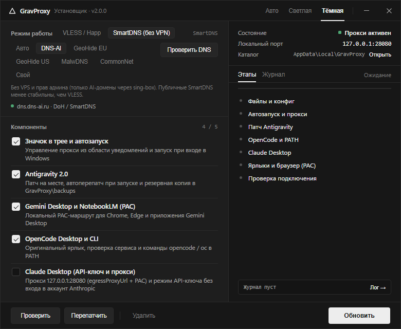

# GravProxy (`grav-proxy`)

**Русский** · [English](./README.en.md)

   

Полностью открытый (**Open Source**) нативный однофайловый установщик локального прокси (`127.0.0.1:28080`) и PAC-маршрутизатора (`127.0.0.1:28081`) на **Go + Wails v2 (WebView2)** со встроенным в процесс ядром `sing-box` (`v1.14.4`, `CGO_ENABLED=0`, `windows/amd64`) для **Antigravity 2.0**, **Gemini Desktop**, **NotebookLM**, **OpenCode Desktop / CLI** и **Claude Desktop** на Windows 10/11 x64 — с основным режимом **VLESS / Happ** и встроенным **SmartDNS (без VPN)**.

Готовый бинарник `GravProxy.exe` доступен на странице [Releases](https://github.com/qlfu/grav-proxy/releases/latest) (`v2.0.0` SHA-256: `A7E8CCA89BE8ECA726A39727B711D1DC1E7264D3CCC1B0C7CE6540473A7A4506`, размер `41 046 528` байт).

> **English summary:** Open-source native **Go + Wails v2 (WebView2)** single-binary installer and tray proxy controller with **in-process embedded `sing-box v1.14.4`** (zero external `.exe` downloads, zero PowerShell/C# compilation, zero temp unpacking) for **Antigravity 2.0**, **Claude Desktop** (`egressProxyUrl` + `3p` API-key mode), **Gemini Desktop**, **NotebookLM**, and **OpenCode** on Windows 10/11 x64. Supports **VLESS / Happ** and a built-in **SmartDNS IP-Health Filtering Relay** (no VPN). Full English guide: [README.en.md](./README.en.md).

<p align="center">
  
</p>

---

## Какие проблемы решает

- **Ошибки `Antigravity 2.0`**:
  - `User location is not supported`
  - `Agent execution terminated due to error.`
  - `There was an unexpected issue setting up your account.` (`Your account is not eligible for Gemini Code Assist for individuals at this time`)
  Установщик автоматически находит подписку/ключ в **Happ**, проверяет **каждый** VLESS-узел через встроенный `sing-box` по **Google GeoIP** (чтение полной 600+ КБ страницы `policies.google.com/terms`), **NotebookLM** и **Gemini** (с фильтрацией `/sorry`), выбирает чистый узел и патчит `agy.exe` / `language_server*.exe` на месте с бэкапом в `%LOCALAPPDATA%\GravProxy\backups\`.
- **Claude Desktop на Windows без входа или с блокировкой региона**: прописывает `egressProxyUrl = http://127.0.0.1:28080` в `%LOCALAPPDATA%\Claude-3p\configLibrary\` (включая MSIX VFS и `%APPDATA%\Claude-3p`) и при указании API-ключа (`sk-ant-...`, `sk-or-...` / шлюз) включает режим `deploymentMode: "3p"` без прав администратора.
- **Доступ к Gemini Desktop, NotebookLM и OpenCode без торможения остального интернета**: встроенный HTTP PAC-сервер `http://127.0.0.1:28081/proxy.pac` направляет в прокси **только целевые AI-домены** — игры, YouTube и обычные сайты идут `DIRECT`.

---

## Архитектура `v2.0.0` (Open Source Go)

Вместо связки PowerShell + C# + внешнего 80-МБ `sing-box.exe` из `v1.x`, весь стек работает **в одном нативном `.exe`**:

| Режим запуска | Как вызывается | Что делает |
| --- | --- | --- |
| **GUI-установщик** | `GravProxy.exe` | Безрамочное окно Wails v2 (WebView2), автоматическое закрытие предыдущего окна GUI (single-instance) |
| **Системный трей** | `GravProxy.exe --tray` | Чистый Win32-значок трея + встроенный `sing-box v1.14.4` (`:28080`) + PAC/control HTTP-сервер (`:28081`) + failover + автообновление |
| **Лаунчер приложений** | `GravProxy.exe --launch antigravity\|opencode\|claude` | Поднимает трей при необходимости, автопроверяет патч и запускает приложение с прокси-флагами/env |
| **Консольный CLI** | `GravProxy.exe --cli <команда>` | Автоматизация и диагностика в терминале без запуска GUI |

Ключевые улучшения `v2.0.0`:
- **Нулевая распаковка во временные папки**: никакого `%TEMP%\ag-proxy-sfx-*`, никакого `csc.exe`, никакого `PowerShell` или внешнего `sing-box.exe`.
- **Умный локальный DNS-релей в режиме SmartDNS (`SmartDNSRelay`)**: гоняет запросы по всем IP DoH/DoT-сервера, пробивает возвращаемый пул SNI-прокси реальным `TLS + SNI` хендшейком и отсекает заблокированные/чёрнодырные IP на российских провайдерах (включая пресет **`DNS-AI`** — `https://dns.dns-ai.ru/dns-query`, **`GeoHide EU`**, **`GeoHide US`**, **`MalwDNS`**, **`CommonNet`** или свой DoH/DoT/IPv4).
- **Быстрый VLESS без 5-секундных AAAA-задержек**: `domain_resolver` с `strategy: "ipv4_only"` вешается только на исходящий VLESS/upstream outbound, не ломая удалённый DNS AI-доменов.
- **Проверка подписки без обрезки 256 КБ и редирект-куки**: поддержка 307/cookie challenge в подписках (`cookiejar`), параллельный опрос узлов на 2 МБ HTML + ранжирование `clean + NotebookLM + Gemini`.
- **Никаких мигающих консольных окон**: все фоновые вызовы и запуск трея работают через `CREATE_NO_WINDOW`, перед патчем/откатом целевые приложения (`Antigravity`, `OpenCode`, `Claude`) корректно закрываются (без убийства родительского терминала/IDE), а «Удалить» полностью вычищает `%LOCALAPPDATA%\GravProxy\`, ярлыки и автозапуск.
- **Автомиграция с `v1.x`**: при установке/удалении автоматически останавливает старые процессы из `%LOCALAPPDATA%\ag-proxy\` и чистит устаревшие записи автозапуска (`Run-Proxy.vbs`, `*.disabled`, `ag-proxy`).

---

## Системные требования

- **ОС**: Windows 10 или Windows 11 (x64).
- **WebView2**: Microsoft Edge WebView2 Runtime (предустановлен в Windows 11 и актуальной Windows 10).
- **Права администратора**: не требуются.
- **Сеть / прокси**: либо подписка / ключ `vless://...` / клиент **Happ**, либо встроенный режим **SmartDNS (без VPN)**.

---

## Быстрый старт (GUI)

1. Скачайте `GravProxy.exe` со страницы [Releases](https://github.com/qlfu/grav-proxy/releases/latest) и запустите.
2. Выберите режим:
   - **VLESS / Happ**: оставьте поле пустым для автоподхвата (Happ / `AG_PROXY_VLESS` / `AG_PROXY_SUB_URL`), нажмите **«Найти в Happ»**, либо вставьте `vless://...`, подписку `https://...` или `socks5://127.0.0.1:10808`.
   - **SmartDNS (без VPN)**: выберите **«Авто»**, **`DNS-AI`**, **`GeoHide EU`** или свой DoH/DoT/IPv4; кнопкой **«Проверить DNS»** можно сразу увидеть, какие AI-сервисы открываются без VPN.
3. Отметьте нужные компоненты (`Значок в трее и автозапуск`, `Antigravity 2.0`, `Gemini Desktop и NotebookLM (PAC)`, `OpenCode Desktop и CLI`, `Claude Desktop`).
4. Нажмите **«Установить»** — активные приложения из выбранных компонентов будут аккуратно закрыты перед патчем, запущен встроенный прокси `:28080`, пропатчены бинарники и ярлыки, и выполнена проверка всех 8 эндпоинтов.

> Поддерживаются темы **Авто / Светлая / Тёмная** (сохраняются в `config.json`).

---

## Командная строка (CLI)

```powershell
# Статус прокси, PAC и найденных приложений
.\GravProxy.exe --cli status

# Live-проверка всех встроенных SmartDNS-серверов
.\GravProxy.exe --cli smartdns-test

# Проверка подключения через локальный прокси 127.0.0.1:28080
.\GravProxy.exe --cli test

# Автоустановка (по умолчанию VLESS / Happ или с флагами SmartDNS)
.\GravProxy.exe --cli install
.\GravProxy.exe --cli install --smartdns
.\GravProxy.exe --cli install --smartdns-url=smartdns://https://dns.dns-ai.ru/dns-query

# Повторно перепатчить Antigravity, OpenCode, Claude Desktop и ярлыки
.\GravProxy.exe --cli repatch

# Полное удаление, откат патчей/ярлыков/PAC и очистка %LOCALAPPDATA%\GravProxy
.\GravProxy.exe --cli uninstall
```

---

## Расположение файлов

- `%LOCALAPPDATA%\GravProxy\`:
  - `GravProxy.exe` — единый бинарник (GUI + `--tray` + `--launch` + `--cli`).
  - `config.json` — сохранённый режим, узел/подписка, тема и список компонентов.
  - `control.token` — локальный случайный 128-битный токен для `/_ctl/*` на `127.0.0.1:28081`.
  - `backups\` — оригинальные копии `agy.exe` / `language_server*.exe` и `manifest.json` (`SHA-256`).
  - `shortcuts-backup.json`, `pac-backup.json`, `app.ico`, `opencode.cmd`, `oc.cmd`.
- `%LOCALAPPDATA%\Claude-3p\configLibrary\` — локальный профиль `3p` для Claude Desktop.
- **Свои домены для PAC**: создайте файл `%LOCALAPPDATA%\GravProxy\pac-domains.txt` (по одному домену в строке, `#` — комментарий).

---

## Сборка из исходников

Требования: **Go 1.27+**, **Node.js 22+**, **Wails CLI v2.17.1**.

```powershell
# 1. Установка Wails CLI (один раз)
go install github.com/wailsapp/wails/v2/cmd/wails@v2.17.1

# 2. Юнит-тесты (без CGO)
$env:CGO_ENABLED = '0'
go test -short -count=1 -tags "with_utls,with_quic" ./...

# 3. Сборка единого GravProxy.exe
wails build -clean -platform windows/amd64 -tags "with_utls,with_quic" -ldflags "-s -w" -skipbindings
```

Структура проекта:
- [`main.go`](./main.go) — точка входа и маршрутизация GUI / `--tray` / `--launch` / `--cli`.
- [`app.go`](./app.go) — Wails-бэкенд для установки, перепатча, проверок и чистого удаления.
- [`internal/engine/`](./internal/engine) — встроенный `sing-box v1.14.4`, `SmartDNSRelay`, пробы узлов и проверка связности.
- [`internal/happ/`](./internal/happ) — парсеры VLESS / Reality / gRPC / WS / SmartDNS / Upstream, работа с подписками и Happ.
- [`internal/pac/`](./internal/pac) — локальный HTTP PAC/control сервер (`:28081`) и настройка WinINet PAC.
- [`internal/patcher/`](./internal/patcher) — атомарный патч Antigravity, ярлыки (COM), Claude Desktop `3p`, OpenCode, single-instance GUI, безопасное закрытие процессов.
- [`internal/tray/`](./internal/tray) — нативный Win32 трей, меню быстрого запуска и failover.
- [`internal/updater/`](./internal/updater) — проверка обновлений GitHub Releases, скачивание по 64 КБ с proxy-fallback и валидация `MZ` + `SHA-256`.
- [`frontend/`](./frontend) — интерфейс установщика (Vite + HTML/CSS/JS).

---

## Безопасность и лицензия

- Подробнее о модели угроз, хранении конфигурации, контрольных суммах и SmartScreen — в [SECURITY.md](./SECURITY.md).
- История релизов — в [CHANGELOG.md](./CHANGELOG.md).
- Лицензия кода проекта: **MIT** ([LICENSE](./LICENSE)). В релизные сборки статически линкуется библиотека [`sing-box`](https://github.com/SagerNet/sing-box) (`v1.14.4`) под лицензией **GPL-3.0-or-later**.
